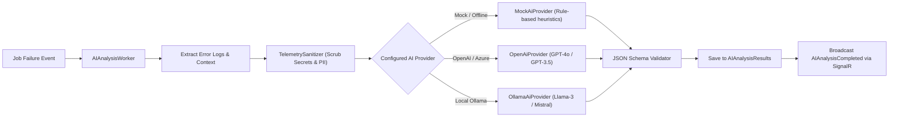

# QueueSense — AI Integration & Failure Diagnostics Architecture

This document describes the design, telemetry sanitization pipeline, provider abstractions, and safety boundaries for the automated AI failure analysis engine.

---

## 1. Diagnostic Architecture & Workflow

When a background job execution transitions to `Failed` or `TimedOut`, `AIAnalysisWorker` triggers root cause analysis asynchronously without blocking the background processing queue.



---

## 2. Telemetry Sanitization & Privacy Boundary

To protect infrastructure security and privacy, **no raw logs or credentials ever leave the application boundary**.

The `TelemetrySanitizer` executes the following regex scrubbing rules prior to provider dispatch:

1. **Bearer & JWT Tokens**: Replaced with `[REDACTED_JWT_TOKEN]`.
   - Pattern: `\beyJ[A-Za-z0-9-_]+\.[A-Za-z0-9-_]+\.[A-Za-z0-9-_]+\b`
2. **Database Connection Strings**: Replaced with `[REDACTED_CONNECTION_STRING]`.
   - Pattern: `(?i)(User ID|Password|Pwd|Server|Host|Database)=[^;]+`
3. **API Keys & Secrets**: Replaced with `[REDACTED_API_KEY]`.
   - Pattern: `(?i)(bearer\s+[a-zA-Z0-9_\-\.]+)|(sk-[a-zA-Z0-9]{20,})|(password\s*[:=]\s*["']?[^"' \r\n]+)`
4. **Email Addresses / PII**: Replaced with `[REDACTED_EMAIL]`.
   - Pattern: `[a-zA-Z0-9._%+-]+@[a-zA-Z0-9.-]+\.[a-zA-Z]{2,}`

---

## 3. Provider Abstraction Contract

```csharp
public interface IAiAnalysisProvider
{
    string ProviderName { get; }
    Task<AiAnalysisOutput> AnalyzeFailureAsync(AiAnalysisContext context, CancellationToken cancellationToken = default);
}

public class AiAnalysisContext
{
    public Guid ExecutionId { get; set; }
    public string JobName { get; set; } = string.Empty;
    public string HandlerType { get; set; } = string.Empty;
    public string ErrorMessage { get; set; } = string.Empty;
    public string? StackTrace { get; set; }
    public List<string> RecentLogs { get; set; } = new();
    public double DurationSeconds { get; set; }
    public int AttemptNumber { get; set; }
    public string? JobConfiguration { get; set; }
}

public class AiAnalysisOutput
{
    public string Summary { get; set; } = string.Empty;
    public List<string> ProbableCauses { get; set; } = new();
    public List<string> SuggestedSolutions { get; set; } = new();
    public string Severity { get; set; } = "Medium"; // Low, Medium, High, Critical
    public string Confidence { get; set; } = "Medium"; // Low, Medium, High
    public bool RetryRecommended { get; set; }
}
```

---

## 4. Provider Implementations

### 4.1 Mock AI Provider (`MockAiProvider`)
- Requires zero API keys or external internet connectivity.
- Analyzes error message patterns (e.g. `TimeoutException`, `SocketException`, `OutOfMemoryException`, `FileNotFoundException`, `HttpRequestException`).
- Produces deterministic, high-accuracy structured diagnoses.
- Enables complete test suite execution and offline development.

### 4.2 OpenAI / Azure OpenAI Provider (`OpenAiProvider`)
- Connects to `/v1/chat/completions` using structured JSON schema response format (`response_format: { type: "json_object" }`).
- Temperature set to `0.2` for deterministic analytical reasoning.
- Configurable via `AI__OpenAI__ApiKey`, `AI__OpenAI__BaseUrl`, `AI__OpenAI__Model`.

### 4.3 Ollama Local Provider (`OllamaAiProvider`)
- Connects to local Ollama instance (default `http://localhost:11434/api/generate`).
- Utilizes `format: "json"` to guarantee JSON adherence.
- Compatible with models like `llama3`, `mistral`, `codellama`.

---

## 5. Strict Safety Guardrails
1. **Advisory Role Exclusively**: AI responses are strictly informational recommendations for human operators.
2. **No Autonomous Database Mutation**: The AI module has no access to execute database updates or code modifications.
3. **Fault-Isolated Execution**: If an AI provider times out or returns malformed JSON, a graceful fallback record is written and normal job scheduling continues without interruption.
