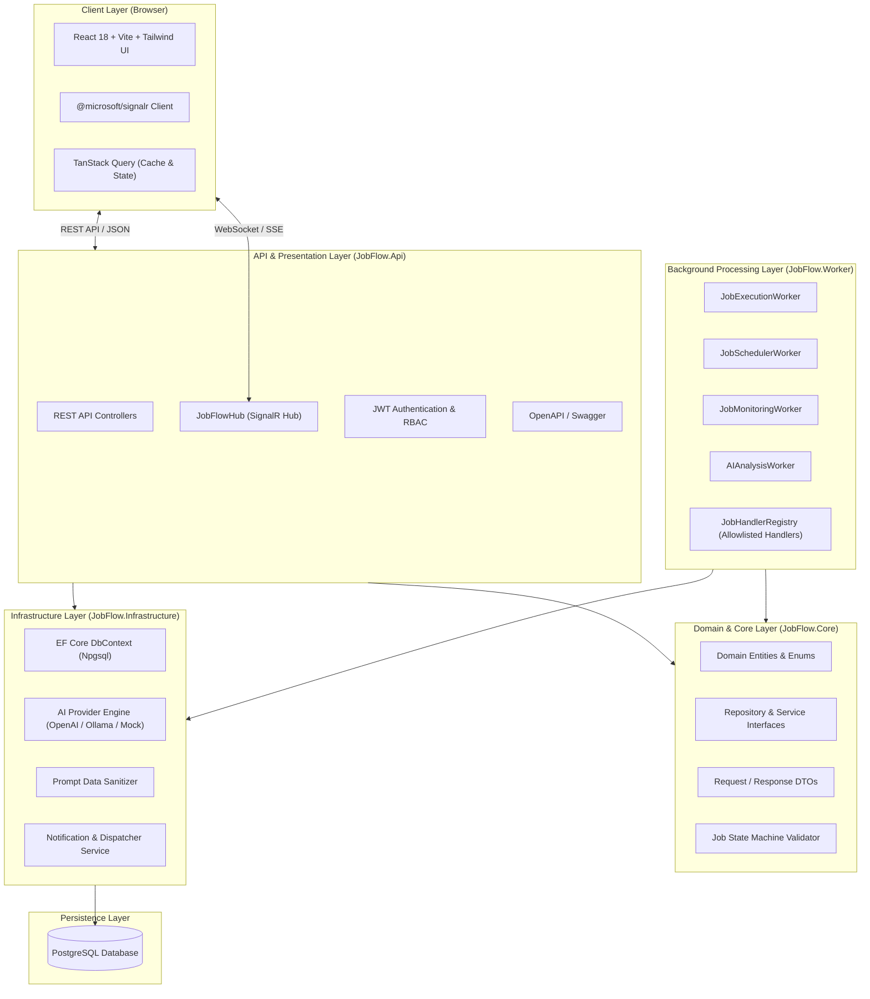
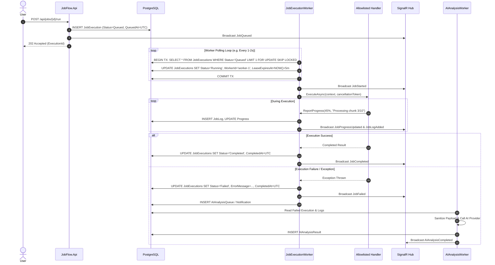

# QueueSense — System Architecture Document

## 1. High-Level Architecture Overview

QueueSense uses a clean, decoupled modular monolithic architecture designed for extreme reliability, clear separation of concerns, and future horizontal microservice extraction.

---

## 2. Component Responsibilities

### 2.1 Frontend (`JobFlow.Client` / `src/frontend`)
- **Technology**: React 18, TypeScript, Vite, Tailwind CSS, Lucide Icons, Recharts, TanStack Query, React Router v6.
- **Responsibilities**:
  - Provides intuitive SaaS UI with Overview, Job Management, Live Monitor, History, AI Analysis, Schedule Management, and Settings.
  - Maintains resilient SignalR connection with automatic reconnect and fallback to polling.
  - Renders real-time progress bars, streamed execution logs, and interactive failure diagnostics.

### 2.2 Backend Web API (`JobFlow.Api`)
- **Technology**: ASP.NET Core 9 (or .NET 8), C#, Serilog, JWT Bearer Auth.
- **Responsibilities**:
  - Exposes RESTful endpoints for CRUD on jobs, schedules, executions, and metrics.
  - Hosts `JobFlowHub` SignalR endpoint with JWT query string authentication.
  - Enforces API input validation, global exception formatting, and CORS policies.

### 2.3 Domain Core (`JobFlow.Core`)
- **Responsibilities**:
  - Encapsulates domain entities (`JobDefinition`, `JobExecution`, `JobSchedule`, `JobLog`, `JobExecutionEvent`, `AIAnalysisResult`, `Notification`, `User`).
  - Defines execution state machine rules and transition guards.
  - Houses interfaces for Job Handlers, AI Providers, and Repositories.

### 2.4 Infrastructure & Data (`JobFlow.Infrastructure`)
- **Technology**: EF Core 9, Npgsql (PostgreSQL Provider), HttpClient.
- **Responsibilities**:
  - Configures EF Core database context with relations, indexes, and concurrency tokens.
  - Implements AI providers (`MockAiProvider`, `OpenAiProvider`, `OllamaAiProvider`).
  - Implements log sanitization to scrub passwords, tokens, and connection strings prior to AI transmission.
  - Manages database seeding (default admin user, sample jobs, demo schedules).

### 2.5 Background Engine (`JobFlow.Worker`)
- **Technology**: .NET `BackgroundService` / `IHostedService`, periodic timers, channel/polling queues.
- **Four Dedicated Background Services**:
  1. `JobExecutionWorker`: Polls the durable queue, acquires distributed database leases, instantiates allowlisted handlers, executes with `CancellationToken`, streams progress and logs, and captures outcomes.
  2. `JobSchedulerWorker`: Computes recurring cron schedules and triggers due executions.
  3. `JobMonitoringWorker`: Scans for abandoned/orphaned executions (expired worker lease) and recovers them, plus flags timeouts.
  4. `AIAnalysisWorker`: Listens for failed executions, prepares sanitized error telemetry, invokes AI provider, persists structured analysis, and notifies users via SignalR.

---

## 3. Durable Database Queue Design

Unlike in-memory queues (e.g., `System.Threading.Channels`), QueueSense stores all queue state in PostgreSQL.

---

## 4. Concurrency, Locking & Lease Management
- **Safe Claiming**: Utilizes PostgreSQL row-level locking (`FOR UPDATE SKIP LOCKED`) or conditional atomic update (`UPDATE ... WHERE Status = 'Queued' AND WorkerId IS NULL`).
- **Heartbeat & Lease Expiration**: While running, the worker refreshes `LeaseExpiresAt` periodically.
- **Crash Recovery**: If a worker process abruptly dies, `JobMonitoringWorker` detects executions in `Running` status whose `LeaseExpiresAt` is in the past, marks them as stalled/recovered, and either retries them or records a `TimedOut`/`WorkerCrashed` failure event.

---

## 5. Security & Isolation Architecture
1. **Allowlisted Handlers Only**: Job handler keys match registered classes in `JobHandlerRegistry`. No `System.Diagnostics.Process`, no dynamic compilation, no `eval`.
2. **AI Privacy Boundary**: Telemetry scrubbing engine strips RFC 3986 credentials, JWTs (`ey...`), API keys (`sk-...`), and database connection strings before external LLM transmission.
3. **RBAC & Endpoint Protection**: All endpoints require JWT authentication except `/api/auth/login` and `/api/auth/register`.
