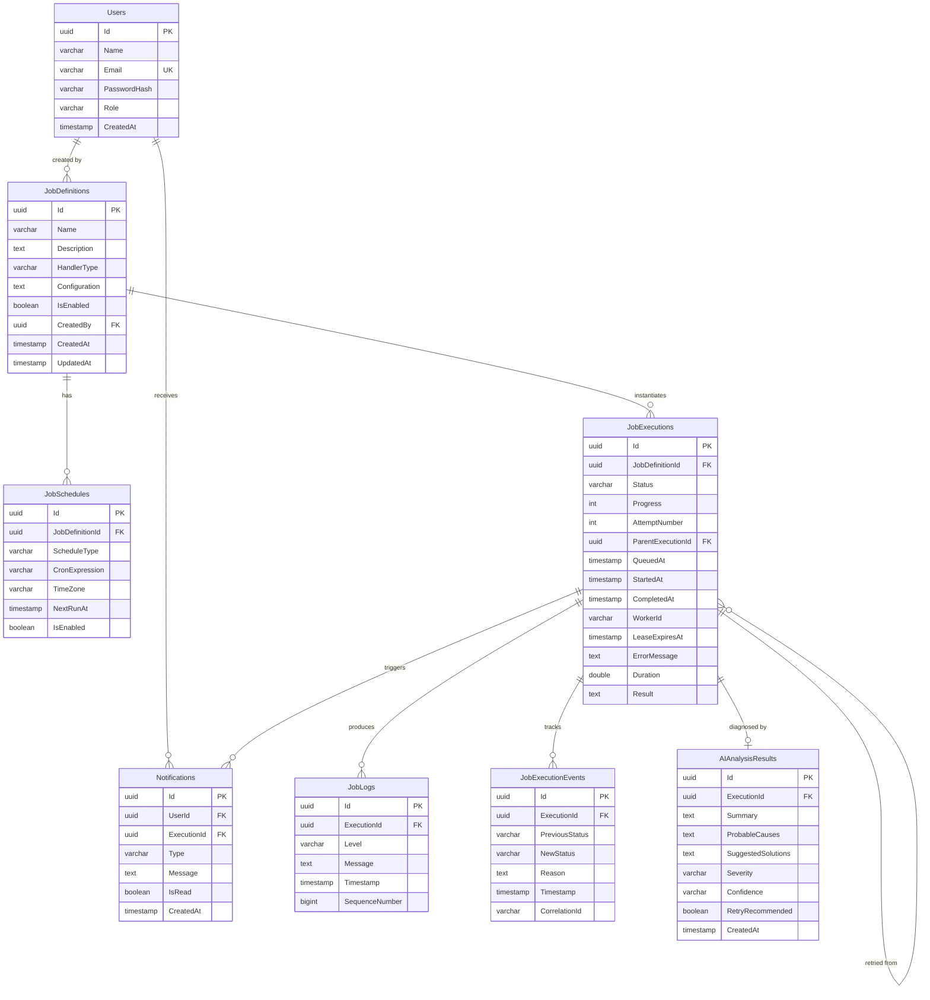

# QueueSense — Database Schema & EF Core Design

This document specifies the PostgreSQL relational schema, Entity Framework Core mappings, indexes, constraints, and data integrity rules for QueueSense.

---

## 1. Entity-Relationship Diagram

---

## 2. Table Specifications & EF Core Configurations

### 2.1 Table: `Users`
- **Primary Key**: `Id` (`uuid`)
- **Columns**:
  - `Name` (`varchar(100)`, NOT NULL)
  - `Email` (`varchar(255)`, NOT NULL, UNIQUE Index)
  - `PasswordHash` (`varchar(500)`, NOT NULL)
  - `Role` (`varchar(30)`, NOT NULL, Default `'Operator'`) — Enum: `Admin`, `Operator`, `Viewer`
  - `CreatedAt` (`timestamp with time zone`, NOT NULL, UTC)

### 2.2 Table: `JobDefinitions`
- **Primary Key**: `Id` (`uuid`)
- **Columns**:
  - `Name` (`varchar(150)`, NOT NULL, Index)
  - `Description` (`text`, NULL)
  - `HandlerType` (`varchar(150)`, NOT NULL) — Allowlisted handler identifier
  - `Configuration` (`text` / JSON, NULL) — Default JSON parameters
  - `IsEnabled` (`boolean`, NOT NULL, Default `true`, Index)
  - `CreatedBy` (`uuid`, NOT NULL, FK -> `Users.Id`)
  - `CreatedAt` (`timestamp with time zone`, NOT NULL, UTC)
  - `UpdatedAt` (`timestamp with time zone`, NOT NULL, UTC)

### 2.3 Table: `JobSchedules`
- **Primary Key**: `Id` (`uuid`)
- **Columns**:
  - `JobDefinitionId` (`uuid`, NOT NULL, FK -> `JobDefinitions.Id` ON DELETE CASCADE)
  - `ScheduleType` (`varchar(30)`, NOT NULL) — Enum: `Immediate`, `DelayedOnce`, `RecurringCron`, `RecurringInterval`
  - `CronExpression` (`varchar(100)`, NULL)
  - `TimeZone` (`varchar(50)`, NOT NULL, Default `'UTC'`)
  - `NextRunAt` (`timestamp with time zone`, NULL, Index)
  - `IsEnabled` (`boolean`, NOT NULL, Default `true`, Index)
- **Index**: Composite Index on `(IsEnabled, NextRunAt)` for high-efficiency scheduler worker polling.

### 2.4 Table: `JobExecutions` (Durable Queue & Run Records)
- **Primary Key**: `Id` (`uuid`)
- **Columns**:
  - `JobDefinitionId` (`uuid`, NOT NULL, FK -> `JobDefinitions.Id` ON DELETE CASCADE, Index)
  - `Status` (`varchar(30)`, NOT NULL, Index) — Enum: `Pending`, `Queued`, `Running`, `Completed`, `Failed`, `TimedOut`, `CancellationRequested`, `Cancelled`
  - `Progress` (`integer`, NOT NULL, Default 0) — Value 0-100
  - `AttemptNumber` (`integer`, NOT NULL, Default 1)
  - `ParentExecutionId` (`uuid`, NULL, FK -> `JobExecutions.Id` ON DELETE SET NULL, Index)
  - `QueuedAt` (`timestamp with time zone`, NOT NULL, UTC, Index)
  - `StartedAt` (`timestamp with time zone`, NULL, UTC)
  - `CompletedAt` (`timestamp with time zone`, NULL, UTC)
  - `WorkerId` (`varchar(100)`, NULL, Index)
  - `LeaseExpiresAt` (`timestamp with time zone`, NULL, UTC, Index)
  - `ErrorMessage` (`text`, NULL)
  - `Duration` (`double precision`, NULL) — Execution duration in seconds
  - `Result` (`text`, NULL) — JSON output data or success summary
- **Queue Polling Index**: Composite index on `(Status, QueuedAt)` for atomic dequeue.
- **Monitoring Lease Index**: Composite index on `(Status, LeaseExpiresAt)` for crash recovery detection.

### 2.5 Table: `JobLogs`
- **Primary Key**: `Id` (`uuid`)
- **Columns**:
  - `ExecutionId` (`uuid`, NOT NULL, FK -> `JobExecutions.Id` ON DELETE CASCADE, Index)
  - `Level` (`varchar(20)`, NOT NULL) — `Debug`, `Information`, `Warning`, `Error`, `Critical`
  - `Message` (`text`, NOT NULL)
  - `Timestamp` (`timestamp with time zone`, NOT NULL, UTC, Index)
  - `SequenceNumber` (`bigint`, NOT NULL)
- **Composite Index**: `(ExecutionId, SequenceNumber ASC)` for fast sequential log streaming.

### 2.6 Table: `JobExecutionEvents` (State Machine History)
- **Primary Key**: `Id` (`uuid`)
- **Columns**:
  - `ExecutionId` (`uuid`, NOT NULL, FK -> `JobExecutions.Id` ON DELETE CASCADE, Index)
  - `PreviousStatus` (`varchar(30)`, NOT NULL)
  - `NewStatus` (`varchar(30)`, NOT NULL)
  - `Reason` (`text`, NULL)
  - `Timestamp` (`timestamp with time zone`, NOT NULL, UTC)
  - `CorrelationId` (`varchar(64)`, NOT NULL)

### 2.7 Table: `AIAnalysisResults`
- **Primary Key**: `Id` (`uuid`)
- **Columns**:
  - `ExecutionId` (`uuid`, NOT NULL, UNIQUE, FK -> `JobExecutions.Id` ON DELETE CASCADE)
  - `Summary` (`text`, NOT NULL)
  - `ProbableCauses` (`text` / JSON array, NOT NULL)
  - `SuggestedSolutions` (`text` / JSON array, NOT NULL)
  - `Severity` (`varchar(20)`, NOT NULL) — `Low`, `Medium`, `High`, `Critical`
  - `Confidence` (`varchar(20)`, NOT NULL) — `Low`, `Medium`, `High`
  - `RetryRecommended` (`boolean`, NOT NULL, Default `false`)
  - `CreatedAt` (`timestamp with time zone`, NOT NULL, UTC)

### 2.8 Table: `Notifications`
- **Primary Key**: `Id` (`uuid`)
- **Columns**:
  - `UserId` (`uuid`, NULL, FK -> `Users.Id` ON DELETE CASCADE, Index)
  - `ExecutionId` (`uuid`, NULL, FK -> `JobExecutions.Id` ON DELETE CASCADE)
  - `Type` (`varchar(50)`, NOT NULL) — `JobFailed`, `JobStalled`, `AiAnalysisReady`, `ScheduleTriggered`
  - `Message` (`text`, NOT NULL)
  - `IsRead` (`boolean`, NOT NULL, Default `false`, Index)
  - `CreatedAt` (`timestamp with time zone`, NOT NULL, UTC, Index)

---

## 3. Database Indexes Summary
1. `IX_JobExecutions_Status_QueuedAt`: Fast queue claim.
2. `IX_JobExecutions_Status_LeaseExpiresAt`: Fast crashed worker heartbeat detection.
3. `IX_JobSchedules_IsEnabled_NextRunAt`: Fast scheduler worker polling.
4. `IX_JobLogs_ExecutionId_SequenceNumber`: Fast ordered live log retrieval.
5. `IX_JobExecutionEvents_ExecutionId_Timestamp`: Audit chronological replay.
