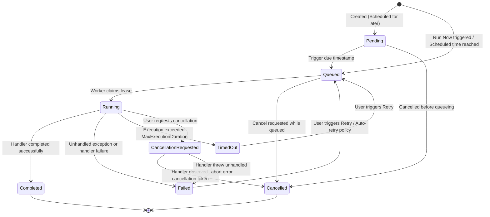
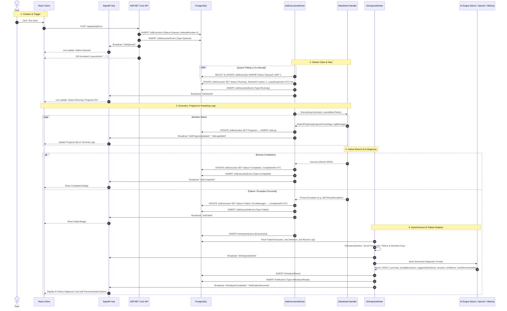
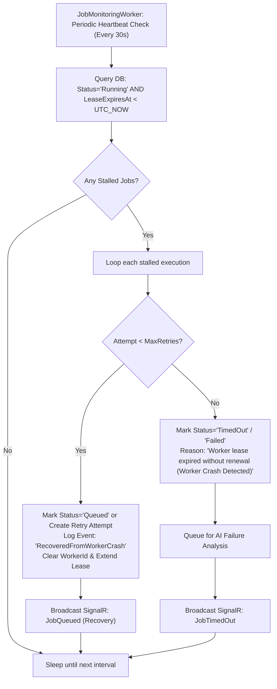

# QueueSense — Background Job Lifecycle & Workflow Specifications

This document defines the complete state machine, execution lifecycle, transitions, fault tolerance, and recovery protocols in QueueSense.

---

## 1. Execution State Machine

### 1.1 Valid State Transitions Table

| Previous Status | New Status | Trigger / Condition | Valid Next Action |
|---|---|---|---|
| `Pending` | `Queued` | Scheduled time reached (`NextRunAt <= UTC`) | Worker will claim |
| `Pending` | `Cancelled` | User cancels scheduled run | Terminal state |
| `Queued` | `Running` | Worker claims execution lease via atomic DB update | Execution starts |
| `Queued` | `Cancelled` | User cancels before worker claims | Terminal state |
| `Running` | `Completed` | Handler completes execution cleanly | Terminal state |
| `Running` | `Failed` | Handler throws exception or fails explicitly | AI Analysis triggered |
| `Running` | `TimedOut` | Execution duration exceeds configured limit | AI Analysis / Retry |
| `Running` | `CancellationRequested` | User triggers POST `/api/executions/{id}/cancel` | Token signalled |
| `CancellationRequested` | `Cancelled` | Handler confirms cancellation | Terminal state |
| `CancellationRequested` | `Failed` | Handler aborted abruptly with error | AI Analysis |
| `Failed` | `Queued` (New Attempt) | User clicks Retry or policy retries | New linked execution record |
| `TimedOut` | `Queued` (New Attempt) | User clicks Retry | New linked execution record |

---

## 2. End-to-End Lifecycle Sequence Diagram

---

## 3. Worker Crash & Stalled Job Recovery Workflow

---

## 4. Cooperative Cancellation Protocol

1. **User Action**: User clicks "Cancel Job" on UI -> `POST /api/executions/{id}/cancel`.
2. **State Transition**: Backend transitions `Status` to `CancellationRequested`.
3. **Signal Delivery**:
   - The executing worker holds an internal dictionary `ConcurrentDictionary<Guid, CancellationTokenSource>`.
   - The cancellation request triggers `cts.Cancel()`.
4. **Handler Compliance**:
   - Handlers check `cancellationToken.ThrowIfCancellationRequested()` periodically during loops.
   - Handlers release resources and cleanly rethrow `OperationCanceledException`.
5. **State Finalization**:
   - The worker catches `OperationCanceledException`, records `Status = Cancelled`, writes cancellation audit log, and emits `JobCancelled` via SignalR.
