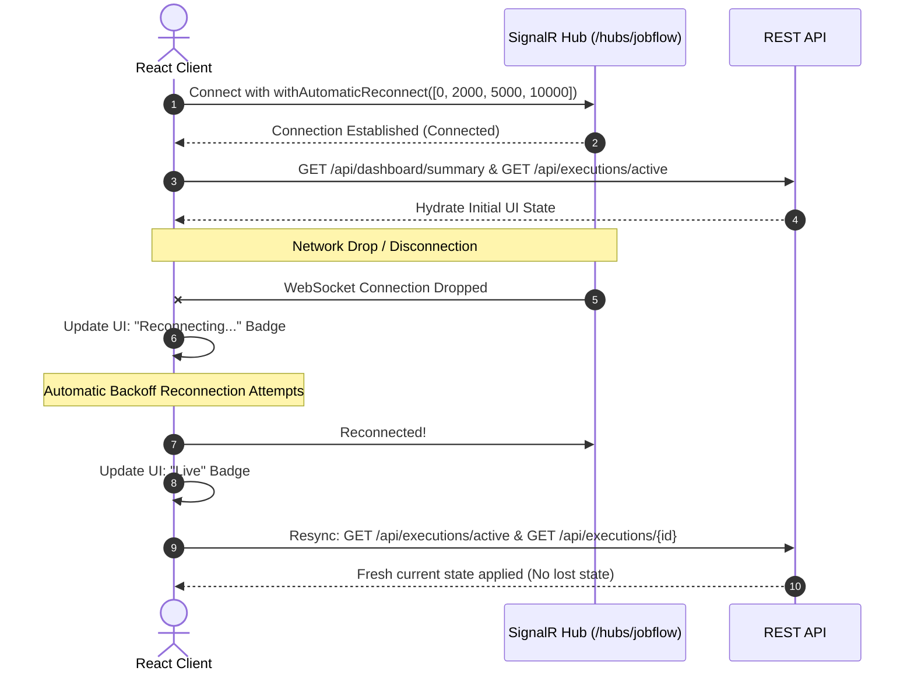

# QueueSense — SignalR Real-Time Event Architecture

This document defines the real-time event hub contract, event payloads, channel subscription models, and client reconnection protocols.

---

## 1. Hub Configuration & Security

- **Hub Route**: `/hubs/jobflow`
- **Authentication**: JWT Bearer token passed via WebSocket handshake query parameter `?access_token=<token>`.
- **Authorization**: Restricts hub methods and event listening to authenticated users.

---

## 2. Strongly-Typed Hub Client Interface (`IJobFlowHubClient`)

```csharp
public interface IJobFlowHubClient
{
    Task ReceiveJobQueued(JobEventPayload payload);
    Task ReceiveJobStarted(JobEventPayload payload);
    Task ReceiveJobProgressUpdated(JobProgressPayload payload);
    Task ReceiveJobLogAdded(JobLogPayload payload);
    Task ReceiveJobCompleted(JobEventPayload payload);
    Task ReceiveJobFailed(JobEventPayload payload);
    Task ReceiveJobCancelled(JobEventPayload payload);
    Task ReceiveJobTimedOut(JobEventPayload payload);
    Task ReceiveAIAnalysisStarted(JobEventPayload payload);
    Task ReceiveAIAnalysisCompleted(AiAnalysisEventPayload payload);
    Task ReceiveNotification(NotificationPayload payload);
}
```

---

## 3. Strongly-Typed Event Payloads

### 3.1 Standard Job Lifecycle Payload (`JobEventPayload`)
```json
{
  "eventId": "b3e0c091-628f-4318-bd75-4ceb60451cf2",
  "jobId": "e67451a9-b3a1-4389-8d75-c54641eeec4a",
  "executionId": "8b9487c6-2c5e-4509-90d5-538adbe55fe1",
  "eventType": "JobStarted",
  "timestamp": "2026-11-11T11:50:02Z",
  "status": "Running",
  "message": "Execution started by worker-alpha-01",
  "metadata": {
    "attemptNumber": 1,
    "handlerType": "SampleDataProcessingJobHandler"
  }
}
```

### 3.2 Job Progress Payload (`JobProgressPayload`)
```json
{
  "eventId": "c71a3981-d112-4f3b-85ef-9689f4175b2a",
  "jobId": "e67451a9-b3a1-4389-8d75-c54641eeec4a",
  "executionId": "8b9487c6-2c5e-4509-90d5-538adbe55fe1",
  "eventType": "JobProgressUpdated",
  "timestamp": "2026-11-11T11:50:08Z",
  "progressPercentage": 45,
  "status": "Running",
  "message": "Processing chunk 3/5"
}
```

### 3.3 Job Log Stream Payload (`JobLogPayload`)
```json
{
  "eventId": "f51203aa-9304-4b52-b8ce-35a81cf2611a",
  "executionId": "8b9487c6-2c5e-4509-90d5-538adbe55fe1",
  "eventType": "JobLogAdded",
  "timestamp": "2026-11-11T11:50:08.450Z",
  "sequenceNumber": 14,
  "level": "Information",
  "message": "Processed record [ID: 350-400] successfully"
}
```

### 3.4 AI Analysis Completed Payload (`AiAnalysisEventPayload`)
```json
{
  "eventId": "900ab1fe-2201-4475-81fa-223455bcdd99",
  "executionId": "8b9487c6-2c5e-4509-90d5-538adbe55fe1",
  "eventType": "AIAnalysisCompleted",
  "timestamp": "2026-11-11T11:50:20Z",
  "summary": "Database connection timeout during transactional commit.",
  "severity": "High",
  "confidence": "High",
  "retryRecommended": true
}
```

---

## 4. Client Connection Lifecycle & Reconnection Protocol



### 4.1 Group Subscriptions
To avoid flooding all clients with high-frequency logs, execution detail views join specific groups:
- `SubscribeToExecution(Guid executionId)`: Client joins group `execution-{id}` to receive high-frequency `JobLogAdded` and `JobProgressUpdated` events.
- `UnsubscribeFromExecution(Guid executionId)`: Client leaves group when navigating away.
- Global events (`JobQueued`, `JobCompleted`, `JobFailed`, `NotificationReceived`) are broadcast to all authorized clients.
